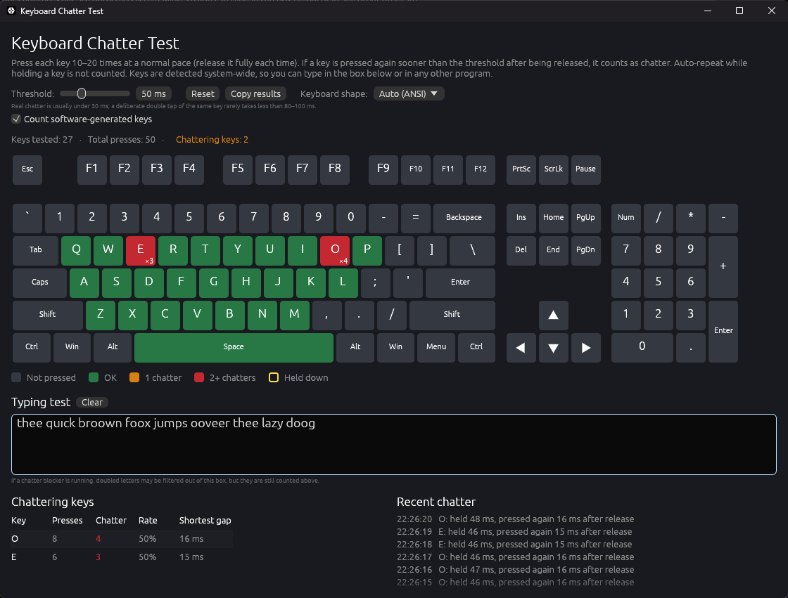

# Keyboard Chatter Test

A small Windows app that finds out **which keys on your keyboard chatter**: one physical press that
registers as two (or more) presses, so you get doubled letters like "helllo".



## Download

Get `KeyboardChatterTest.exe` from the [Releases](../../releases) page. It is a single portable file:
there's nothing to install, and it needs no administrator rights.

Windows may show a SmartScreen warning because the file is not code-signed. Click "More info" → "Run anyway".

## How to use

1. Run `KeyboardChatterTest.exe`.
2. Press each key 10–20 times at a normal pace, releasing it fully each time. You can type in the built-in
   **Typing test** box, or in any other program. Keys are detected system-wide.
3. Keys change color on the on-screen keyboard:
   - **gray**: not pressed yet
   - **green**: no chatter
   - **orange**: chattered once
   - **red**: chattered two or more times
4. The **Chattering keys** table lists the presses, chatter count, rate and shortest gap for each key.
   **Copy results** copies the table as text.

## How it works

A press counts as chatter when the same key is pressed again **sooner than the threshold after it was
released**. The default threshold is 50 ms, and you can change it with the slider. Results are recalculated
instantly, so you don't need to retest.

- Real chatter is usually under 30 ms. A person deliberately double-tapping the same key rarely manages it in
  under 80–100 ms.
- Auto-repeat while holding a key down is not counted.
- Key events are only observed, never modified or blocked.

Key events come from two sources:

- **When another program is in front**, a low-level keyboard hook (`WH_KEYBOARD_LL`) observes the keys.
  Chatter-blocking tools work the same way. Start this app *after* your blocker (for example
  [KeyboardChatterBlocker](https://github.com/mcmonkeyprojects/KeyboardChatterBlocker)) and it sees key presses
  before the blocker drops them. Then you can test your keyboard without turning the blocker off.
- **When this app's own window is in front**, Windows does not call low-level hooks, so the app reads keys
  through Raw Input instead. Chatter blockers don't run then either, so the typing box shows the doubled letters.

### Keyboard software that re-sends keys

Some keyboard utilities and key remappers re-send every key you press as a software-generated key. The app
ignores software-generated keys by default and shows how many it ignored. If your presses aren't being
counted, tick **Count software-generated keys**.

## Building from source

Requires [Rust](https://rustup.rs/) on Windows.

```
cargo build --release
```

The executable is written to `target\release\keyboard-chatter-test.exe`.

## License

[MIT](LICENSE)
